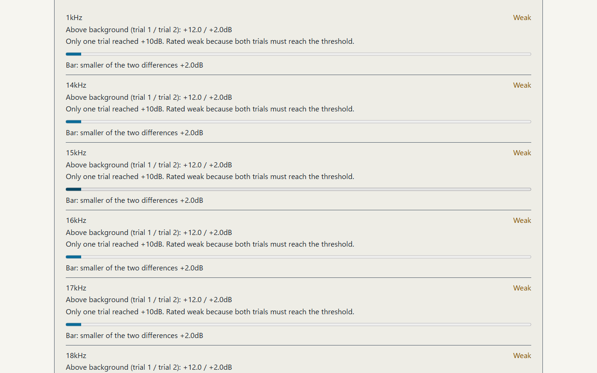
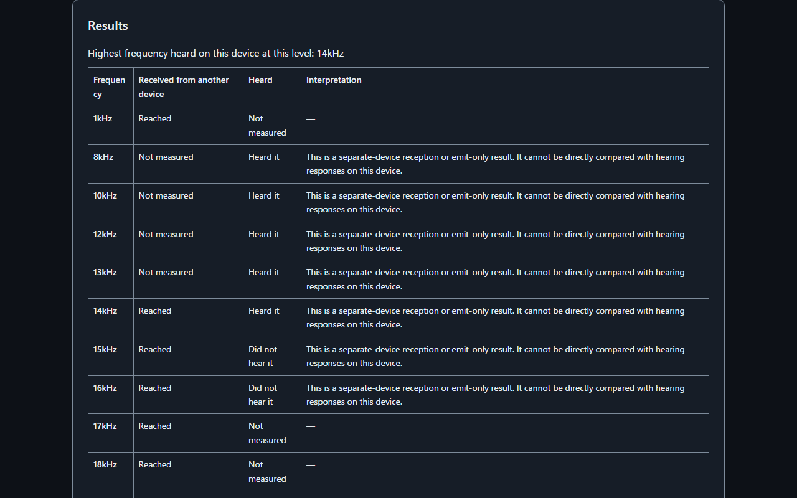

English · [日本語](README.md)

# Ultrasonic Reach Meter - Separate device reach from your hearing limit


[](https://ipusiron.github.io/ultrasonic-reach-meter/)

**Day119 - 200 Security Tools Created with Generative AI**

Ultrasonic Reach Meter is a learning tool for exploring how far your device's speaker and microphone reach into near-ultrasound (14–21.5kHz), separately from the highest frequency you can hear.

A device may emit and receive a sound you cannot hear. Measure the device path first, then compare hearing responses at the same frequencies. This helps distinguish a received signal from a limitation somewhere in the speaker, microphone or audio processing. It introduces the 18–20kHz band used by ultrasonic beacons.

## 🌐 Demo

👉 **[Open Ultrasonic Reach Meter](https://ipusiron.github.io/ultrasonic-reach-meter/)**

You can also open a downloaded `index.html` via file://. Microphone access depends on the browser and permission settings. Use the HTTPS demo on iPhone. No installation or build is needed.

## 📸 Screenshots



*Headless Chromium on Windows received a synthetic WAV. Tones at 18–20kHz were detected; absent tones at 20.5–21.5kHz were not. The differences are relative FFT power values, not measurements of a physical speaker and microphone. The Japanese screenshots also show a 48000Hz AudioContext, a 21.5kHz ceiling and all three processing settings off.*



*This scripted interaction answered “Heard” up to 14kHz, “Not heard” at 15 and 16kHz, and “Heard” again when confirming 14kHz. It is not a measurement of a person's hearing. Receive-only results and hearing responses are labeled as separate conditions.*

## ✨ Features

| Section | Content |
|---|---|
| 1. Before starting | Volume and surroundings, default −30dBFS gain with a −12dBFS cap |
| 2. This environment | Actual AudioContext sampleRate, frequency ceiling, echo cancellation, noise suppression and automatic gain settings |
| 3. Device reach | Both, send only and receive only; bars and status for each frequency |
| 4. Hearing limit | Heard / Not heard responses and one replay per step |
| 5. Results | Device results and hearing responses by frequency, with condition-dependent interpretation |
| 6. Lessons | Ten sections on beacons, MFSK, device bandwidth and age-group research references, with primary sources |

Switch between Japanese and English, and between dark and light themes. Language changes preserve results and the current response step. The initial theme is blueprint blue. The header's “?” opens help; Esc closes it.

## 📖 Usage

The easiest starting point is one device: finish “Emit and receive,” then continue with “What you can hear.” Help includes three SVG diagrams for emit-and-receive, emit-only and receive-only roles, showing which device emits and which receives.

1. Choose a place without people or pets nearby and start with low device volume. Keep speakers away from ears.
2. For one device, select “Both,” start measurement and allow microphone access. Read the actual settings in “This environment.”
3. The sequence starts with a 1kHz self-check. If it is not received, measurement stops; check volume, output route, microphone permission and processing.
4. Start the hearing sequence after device measurement. Answer each step; replay is available once per step. Two consecutive misses end the ascent, followed by confirmation of the highest heard step.
5. Read the result table. Changed volume or frequencies near the upper limit make interpretation a reference only.

For two devices, select “Emit only” on the PC and “Receive only” on an iPhone or another receiver. Face the speaker and microphone toward each other at about 10cm. Start the receiver first, then the PC. Reception ends after 60 seconds. If the sending sequence exceeds 60 seconds in your environment, the measurement window may not cover every step. The result describes that particular sender-to-receiver path.

“Emit and receive” uses two independent trials. In the 48kHz test environment it took about 79 seconds; “Emit only” took about 38 seconds. Duration varies with sampleRate, output latency and scheduling. The page shows an estimate.

## 🔬 Test tones and classification

An integer-Hz sine wave is calculated into a one-second AudioBuffer and looped for a short burst. Each end uses a 20ms linear ramp. Hearing bursts last 1.5 seconds. Device bursts allow for output latency followed by eight independent frames.

| sampleRate | Output ceiling | Reference boundary |
|---|---|---|
| 44100Hz | 19500Hz | Above 18389.7Hz |
| 48000Hz | 21500Hz | Above 20016Hz |

The ceiling is `min(21500, floor(0.45 × sampleRate / 500) × 500)`Hz. Frequencies above `0.417 × sampleRate` carry a reference label. Steps above the ceiling are never emitted. Device steps are 1, 14, 15, 16, 17, 18, 18.5, 19, 19.5, 20, 20.5, 21 and 21.5kHz.

AnalyserNode uses fftSize 8192 and smoothingTimeConstant 0. Reads are separated by `max(171ms, ceil(8192 / sampleRate × 1000)ms)`: 171ms at 48kHz and 186ms at 44.1kHz. The maximum linear power within ±2 bins is averaged across eight frames. Decibel values are not averaged directly.

| Role | Classification |
|---|---|
| Emit and receive | Compare eight silent frames immediately before the tone with eight tone frames. Two independent trials in succession at +10dB or higher mean reached; otherwise a maximum difference of at least +4dB is weak, and less is not reached. |
| Emit only | Display each frequency and emit a short burst. No microphone or reach classification. |
| Receive only | Use the temporal median of each band over 60 seconds as background, compared with eight-frame moving averages. Two evaluations above +10dB separated by at least 0.5 seconds mean reached; both may occur within one burst. |

In receive-only mode, signal and background powers are each floored at 10⁻¹² (−120dB in FFT values) before their ratio is calculated. This prevents tiny numerical components from being classified as received solely because of a large ratio. A synthetic input produced +15.1dB at the absent 21.5kHz tone against background near −173dB. This design floor is not a calibrated sound-pressure value and may miss faint signals. It does not apply to “Both.”

The hearing result means “the highest frequency heard on this device at this volume.” A failed final confirmation leaves it unconfirmed. Changed gain, different sampleRate or gain between device and hearing measurements, and reference-band frequencies qualify the interpretation.

## 🎯 Use cases

Try these four examples tied to the tool's measurements.

- Compare device reach and hearing responses at 18, 19 and 20kHz to explore when a device receives a sound you cannot hear.
- Send from a PC to a second device at about 10cm to examine the receiving path with separate send-only and receive-only roles.
- Read the 19.5kHz ceiling at 44.1kHz and the 21.5kHz ceiling at 48kHz to learn how sampleRate changes the usable range.
- Compare reported echo cancellation and noise suppression with reach to explain why frequency limits do not depend on hearing alone.

In a lesson, use the MFSK table to connect frequencies and symbols. For long-term sound-level records, continue with Mic Gain Logger.

## 🌍 Browser differences

Behavior does not branch on browser names. The tool checks available features and uses actual sampleRate and getSettings() values. Safari and physical-device observations below come from documentation and existing reports; they are separate from this tool's automated tests.

| Item | Chrome / Vivaldi (Chromium) | Firefox | Safari (Mac / iPhone) | How to tell |
|---|---|---|---|---|
| sampleRate | Output-device dependent; not forced | Same; some versions reject a microphone/context rate mismatch | Depends on device and audio route; changes have been reported | Actual `ctx.sampleRate` |
| Test tones | AudioBuffer avoids high-frequency OscillatorNode attenuation | The calculated ceiling avoids aliases above Nyquist | Same AudioBuffer method | Sequence derived from actual rate |
| Disabling processing | Request EC, NS and AGC false, then check actual settings | Request supported constraints and show reported values | Some devices report only EC; NS and AGC may be unreported | On / off / unreported from `getSettings()` |
| Remaining processing | EC or NS may remove high bands | Depends on input and settings | Historical reports of missing high bands | Warning, 1kHz self-check and sequence results |
| file:// microphone | Available in automated tests | Feature availability checked in automated tests | Physical devices untested; HTTPS recommended on iPhone | `navigator.mediaDevices` and permission outcome |
| Starting audio | Button press | Same | Same | AudioContext state |
| Silent mode and routing | Depends on output route | Depends on output route | If audioSession exists: play-and-record with microphone, playback otherwise | Presence of `navigator.audioSession` |
| Output while using mic | Device and route dependent | Same | Reports of reduced quality or switching to earpiece | Self-check and actual output route |
| Bluetooth | A headset microphone may narrow bandwidth | Same | Same | Selected device and self-check |

Chrome on iPhone also uses WebKit, so consider the same audio-route limitations as Safari. “Unreported” does not mean off. If EC or NS is on, a warning offers continue or cancel before measurement.

Verified coverage: Playwright Chromium, Firefox and WebKit layout on Windows, HTTP and file://, Japanese and English, widths from 320 to 1280px. Audio flows used headless Chromium with a synthetic WAV. Firefox's actual rate and ceiling were checked. The Windows WebKit port lacks audio APIs and is not a substitute for physical Safari testing.

Unverified: physical Safari on Mac and iPhone, physical Chrome/Vivaldi speakers and microphones, Android and screen-reader speech. Synthetic input reported a 44100Hz microphone and a 48000Hz AudioContext. Requested rates and processing constraints are not guaranteed to be adopted.

## ⚠️ Limitations and assumptions

- This is not a medical examination and does not estimate age. Devices and volumes are uncalibrated.
- It does not determine whether tracking is occurring, whether an app responds, or a beacon's content or source.
- A failed device path does not isolate the speaker, microphone, processing or distance as the cause.
- Receive-only results can include unrelated environmental sounds. Persistent tones also enter the temporal median and may show a smaller difference.
- Gain in dBFS and FFT differences are not dB SPL. Do not compare them directly with age-group research tables.
- Hearing responses depend on attention, surroundings and volume. Do not increase device volume to chase an inaudible tone.

Start quietly. Take particular care with earphones and headphones; stop immediately if you experience ringing, headache or discomfort. Keep speakers away from ears and use a place without people or pets nearby.

IPUSIRON is an author of technical books on security. The author does not encourage misuse of this tool.

## 🔒 Privacy and safeguards

No audio is recorded. Microphone values undergo FFT locally, with band powers temporarily retained for classification. There is no feature to save or transmit measurement results or hearing responses.

Only `ultrasonic-reach-meter.lang` and `ultrasonic-reach-meter.theme` are stored in localStorage. No sessionStorage, cookies or IndexedDB are used. CSP `connect-src 'none'` restricts connections; textContent and createElement build the UI. There are no CDNs, external fonts or package dependencies.

There is no continuous-play button, and sequences end automatically. The stop button, a hidden tab, a disconnected microphone or interrupted audio stops measurement. Leaving the page closes AudioContext; stopping releases the microphone.

## 🔗 Related tools

### Day041 Mic Gain Logger

This tool grew out of the [tone-source page (Tone Sweep)](https://ipusiron.github.io/mic-gain-logger/tone_sweep.html) used for physical-device testing of [Day041 Mic Gain Logger](https://github.com/ipusiron/mic-gain-logger), rebuilt as a standalone learning tool.
The original page raised the test-tone frequency in steps to check how high a smartphone microphone could pick it up.
Mic Gain Logger is available on its [demo page](https://ipusiron.github.io/mic-gain-logger/).

Day119 provides an active test: play test tones and check whether they reach the microphone at that moment.
In Receive only mode, another device supplies the test tones.
Day041 provides passive observation: it continuously logs sound levels and energy in the ultrasonic band (18–22kHz) over longer periods without recording audio.
Neither tool identifies what the sound is.

First, use Day119 in Receive only or Both (emit and receive) mode to check which test frequencies within 18–21kHz are available on the device and can reach its microphone.
Then use Day041 on the same device to record the ultrasonic band under ordinary conditions.
Checking which frequencies can be received helps you distinguish between a microphone that cannot pick up that band and an absence of sound in that band when Day041 shows no response.
However, a Not reached result in Day119 alone cannot separate limitations of the speaker, microphone, audio processing, or distance.
Check the input device, browser, sample rate, and audio-processing settings in both tools, and account for any differences when reading the log.

Conversely, if Day041 shows periods when ultrasonic-band energy is above its usual level, use Day119 to check that the same device can receive that band so you have a basis for interpreting the log.
This does not identify the type or source of the sound.

## 📚 References

- [Mavroudis et al., On the Privacy and Security of the Ultrasound Ecosystem (2017)](https://www.petsymposium.org/popets/2017/popets-2017-0018.pdf)
- [Arp et al., Privacy Threats through Ultrasonic Side Channels on Mobile Devices (2017)](https://vamos.mlsec.org/docs/2017a-eurosp.pdf)
- [FTC's SilverPush warning (2016)](https://www.ftc.gov/news-events/press-releases/2016/03/ftc-issues-warning-letters-app-developers-using-silverpush-code)
- [W3C Web Audio API](https://www.w3.org/TR/webaudio-1.0/), [Media Capture and Streams](https://www.w3.org/TR/mediacapture-streams/)
- [Lee et al. (2012)](https://pmc.ncbi.nlm.nih.gov/articles/PMC3606020/), [Wang et al. (2021)](https://pmc.ncbi.nlm.nih.gov/articles/PMC8394048/)
- [Historical WebKit report 179411](https://bugs.webkit.org/show_bug.cgi?id=179411), [311451](https://bugs.webkit.org/show_bug.cgi?id=311451), [326286](https://bugs.webkit.org/show_bug.cgi?id=326286)

## 📁 Directory structure

```text
ultrasonic-reach-meter/
├── .github/workflows/test.yml
├── .gitignore
├── LICENSE
├── README.md
├── README.en.md
├── CLAUDE.md
├── package.json
├── index.html
├── style.css
├── tone-core.js
├── audio-io.js
├── messages.js
├── app.js
├── assets/
│   ├── environment.png
│   ├── reach.png
│   ├── hearing.png
│   └── en/
│       ├── reach.png
│       └── hearing.png
└── test/
    ├── audio.test.js
    ├── claims.test.js
    ├── contrast.test.js
    ├── format.test.js
    ├── html.test.js
    ├── readme.test.js
    └── tone-core.test.js
```

tone-core.js contains DOM-independent calculations; audio-io.js manages audio and microphone access; app.js manages UI and interaction; messages.js contains Japanese and English copy.

## 💻 Requirements

A browser with Web Audio API is required. “Emit and receive” and “Receive only” also require microphone permission. Development checks require Node.js 22 or later, with no package installation.

```sh
npm test
find . -name '*.js' -not -path './.git/*' -print0 | xargs -0 -n1 node --check
```

Run the syntax command in a shell such as Git Bash. CI performs these checks on push and pull_request.

## 📄 License

[MIT License](LICENSE). The palette, help, language switching, tests and CI structure follow the same author's [Day118 SHA-256 Byte Inspector](https://github.com/ipusiron/sha256-byte-inspector) and [Day117 Hash Chain Tamper Trainer](https://github.com/ipusiron/hash-chain-tamper-trainer).

## 🛠️ About this tool

This is part of “200 Security Tools Created with Generative AI,” building and publishing security tools with AI assistance across the 100 days from Day101 to Day200.

🔗 [Project details and other tools](https://akademeia.info/?page_id=44607)
