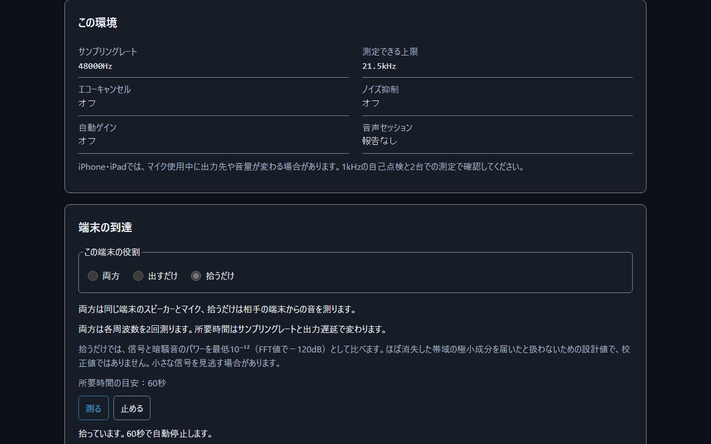
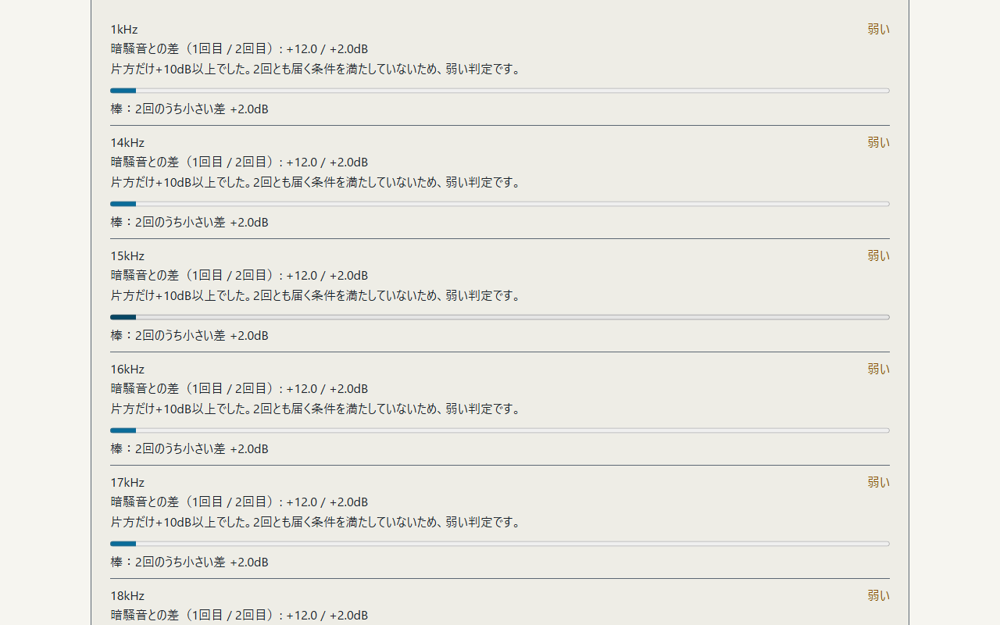
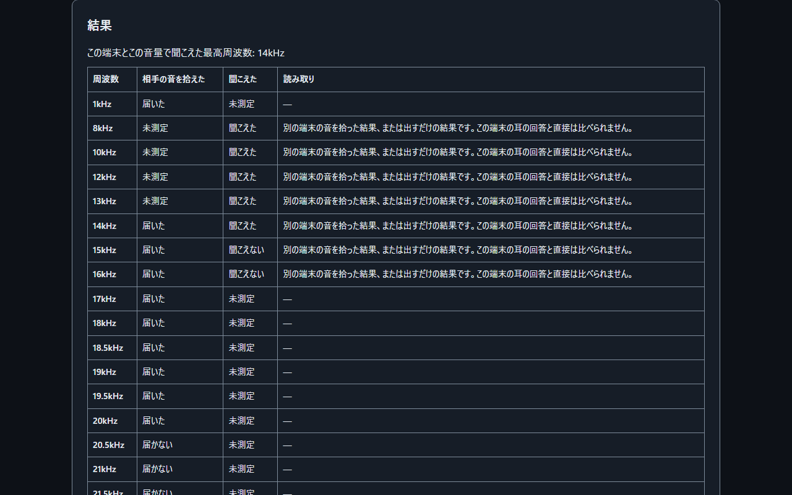
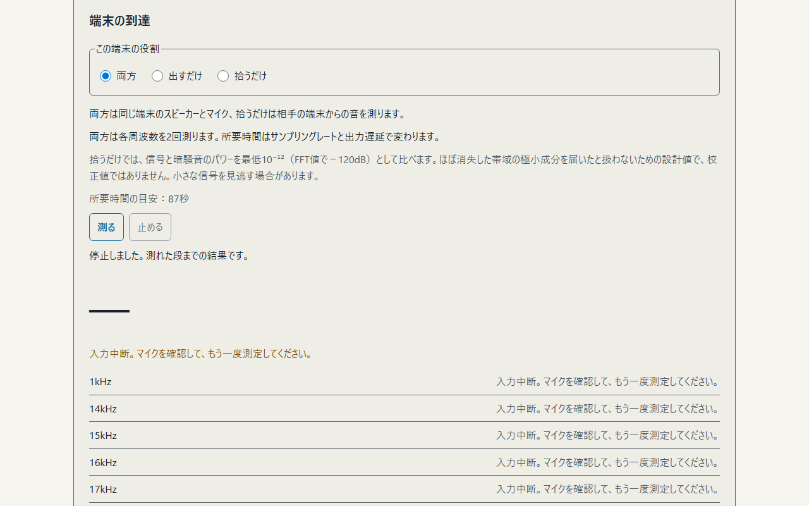

<!--
---
id: day119
slug: ultrasonic-reach-meter
title: "Ultrasonic Reach Meter"
subtitle_ja: "端末の到達と耳の上限を分けて確かめる"
subtitle_en: "Separate device reach from your hearing limit"
description_ja: "スピーカーとマイクの14〜21.5kHzでの到達と、自分の耳で聞こえた最高周波数を分けて確かめる教材"
description_en: "Explore speaker-to-microphone reach at 14–21.5kHz separately from the highest frequency you hear"
category_ja: [プライバシー, 音響監視]
category_en: [Privacy, Acoustic Surveillance]
difficulty: 2
tags: [ultrasound, privacy, web-audio, microphone, hearing, offline]
repo_url: "https://github.com/ipusiron/ultrasonic-reach-meter"
demo_url: "https://ipusiron.github.io/ultrasonic-reach-meter/"
hub: true
---
-->

# Ultrasonic Reach Meter - 端末の到達と耳の上限を分けて確かめる


[](https://ipusiron.github.io/ultrasonic-reach-meter/)

**Day119 - 生成AIで作るセキュリティツール200**

[English](README.en.md) · 日本語

Ultrasonic Reach Meterは、自分の端末のスピーカーとマイクが超音波の近くの帯域（14〜21.5kHz）をどこまで出して拾えるかと、自分の耳がどこまで聞こえるかを、分けて確かめる学習ツールです。

聞こえない音でも、端末は出して拾えることがあります。端末の到達を先に調べ、同じ周波数での耳の回答を並べると、端末では届いていたのか、端末の出力・入力のどこかで届かなかったのかを考えられます。超音波ビーコンが使う18〜20kHzの帯域を学ぶ入口になります。

## 🌐 デモページ

👉 **[Ultrasonic Reach Meterを開く](https://ipusiron.github.io/ultrasonic-reach-meter/)**

ダウンロードした`index.html`をブラウザーで開くと、file://でも使えます。マイクの利用可否はブラウザーと許可設定によります。iPhoneではHTTPSの公開ページを使ってください。インストールとビルドは不要です。

## 📸 スクリーンショット



*測定条件を用意した画面の操作例です。端末測定時の加工3項目はオフ、セッションはplay-and-recordです。耳の測定時はplaybackとなり、両方の条件が残ります。実機のスピーカーとマイクの測定値ではありません。*



*2回の差を+12.0/+2.0dBにした表示例です。片方だけが+10dB以上なので「弱い」となり、棒には2回のうち小さい差を表示します。実機の測定値ではありません。*



*13kHzまで「聞こえた」、14kHzと15kHzで「聞こえない」、13kHzの確認で「聞こえた」を選んだ操作例です。人の耳を測った結果ではありません。セッションの差と高域の理由を分けて表示します。*



*マイクの中断を模した表示例です。この回の結果を「入力中断」とし、「届かない」と区別します。入力が戻っても自動再開せず、利用者が再測定を始めます。*

## ✨ 機能

| 節 | 内容 |
|---|---|
| 1. 始める前に | 音量と使用場所の注意、初期−30dBFS・上限−12dBFSのゲイン |
| 2. この環境 | 端末測定時と耳の測定時のsampleRate、加工3項目、セッション、開始時音量、出力遅延、マイクのレートとチャンネル数 |
| 3. 端末の到達 | 両方・出すだけ・拾うだけの3役、周波数ごとの棒と判定 |
| 4. 耳の上限 | 聞こえた／聞こえない、各段で1回だけ再生し直せる操作 |
| 5. 結果 | 周波数ごとの端末の結果と耳の回答、条件に応じた読み取り |
| 6. 座学 | 超音波ビーコン、MFSK、端末の帯域、年齢別の研究上の参考値など10節と一次資料 |

日本語・英語、明暗の表示を切り替えられます。言語を変えても測定結果と回答の位置は保ちます。初期表示は青焼きのダーク配色です。見出し右の「?」でヘルプを開き、Escで閉じられます。

## 📖 使い方

まずは1台で「出して拾う（両方）」を終えてから、「耳の上限」へ進む手順が手軽です。ヘルプには、両方、出すだけ、拾うだけの3つのSVG図があります。2台で使う場合も、この端末と相手の端末の役割を確認できます。

1. 周りの人やペットがいない場所で、端末の音量を小さくする。スピーカーを耳に近づけない
2. 1台で確かめるときは「両方」を選び、「測る」を押す。マイクの使用を許可し、「この環境」の実値を読む
3. 1kHzの自己点検から高域へ進む。自己点検で「届かない」なら停止するので、音量・出力先・マイクの許可・音の加工を確かめる
4. 端末の到達が終わったら「耳の上限」を始め、各段で聞こえたかを回答する。「もう一度」は各段で1回まで。2段続けて聞こえなければ上りを終え、最後に聞こえた最高の段を確認する
5. 結果の表を読む。音量を変えた場合や上限に近い帯域は参考値として扱う

2台で使う場合は、PCを「出すだけ」、iPhoneなどの受信側を「拾うだけ」にします。スピーカーとマイクを正面10cm前後に置き、受信側を始めてからPCを始めてください。「拾うだけ」は60秒で終了します。送信側の階段が60秒を超える環境では、全段を含められない場合があります。受信側での到達は、そのPCからその受信側までの条件を表します。

「両方」は2回の独立した測定を行います。48kHz、採用した出力遅延20msの場合、画面の目安は87秒、「出すだけ」は44秒です。実際の所要時間はsampleRate、出力遅延、描画の遅れで変わります。

マイクの許可待ちは画面に表示します。ミュートや切断が起きた回は「入力中断」となり、「届かない」とは区別します。入力が戻っても以前の背景値で再開しません。マイクを確認して、再測定を始めてください。測定中にヘルプを開くと測定を停止します。

## 🔬 試験音と判定

試験音は整数Hzの正弦波1秒分をAudioBufferに計算し、ループして短く鳴らします。前後20msの直線ランプを付けます。耳の試験音は1.5秒です。端末の試験音は、出力遅延と150msの待機、独立した8フレーム、取得間隔2回分の余裕、終了ランプ20msから長さを決めます。48kHz、出力遅延20msなら1.900秒です。

発音とFFT取得にはAudioContextの同じ時計を使います。8192サンプルの窓全体が安定した発音区間内にあり、前の窓と重ならない8フレームだけを採用します。遅延によって不足した回は「測定条件不足」として中断します。取得の遅れに合わせて発音時間を延ばすことはありません。

| sampleRate | 出力する上限 | 参考値の境界 |
|---|---|---|
| 44100Hz | 19500Hz | 18389.7Hzより上 |
| 48000Hz | 21500Hz | 20016Hzより上 |

上限は`min(21500, floor(0.45 × sampleRate / 500) × 500)`Hzです。`0.417 × sampleRate`より上には参考値の印を付けます。上限を超える段は鳴らしません。端末の階段は1・14・15・16・17・18・18.5・19・19.5・20・20.5・21・21.5kHzです。

AnalyserNodeはfftSize＝8192、smoothingTimeConstant＝0です。読む間隔は`max(171ms, ceil(8192 / sampleRate × 1000)ms)`とし、48kHzでは171ms、44.1kHzでは186msです。対象ビン±2の最大パワーを取り、8フレームの線形パワーを平均します。dB値をそのまま平均しません。

| 役割 | 判定 |
|---|---|
| 両方 | 直前の無音8フレームと発音中8フレームの差。独立した2回が続けて+10dB以上なら「届いた」、最大差が+4dB以上なら「弱い」、それ未満は「届かない」 |
| 出すだけ | 周波数の表示と短い発音。マイクを開かず、到達は判定しない |
| 拾うだけ | 60秒の各帯域の時間中央値を暗騒音とし、8フレーム移動平均を比較。+10dBを超えた評価時点が0.5秒以上離れて2回あれば「届いた」。同じ発音内でもよい |

「両方」は1回目と2回目の差を表示します。棒は2回のうち小さい差です。片方だけが強い場合も、2回とも+10dB以上という条件を満たさなければ「届いた」にはなりません。

| 1回目 | 2回目 | 判定 |
|---|---|---|
| +12.0dB | +2.0dB | 弱い |
| +2.0dB | +12.0dB | 弱い |
| +6.0dB | +2.0dB | 弱い |
| +12.0dB | +12.0dB | 届いた |
| +2.0dB | +2.0dB | 届かない |

「拾うだけ」では、信号と暗騒音のパワーをそれぞれ最低10⁻¹²（FFT値で−120dB）としてから比を取ります。極小の成分同士の比だけで「届いた」になることを防ぐ設計値です。合成入力で、含めていない21.5kHzが約−173dBの暗騒音に対して+15.1dBになる例を確認したため加えました。音圧の校正値ではなく、微弱な信号を拾いにくくなる場合があります。「両方」の判定にはこの下限を適用しません。

耳の結果は「この端末とこの音量で聞こえた最高周波数」です。最後の確認で聞こえなければ確定しません。参考の理由は「高域」「測定途中の音量変更」「測定条件の差」に分けて、周波数、結果行、最高値に表示します。耳だけの測定でも44.1kHzの18.5kHz以上、48kHzの20.5kHz以上は参考値です。

端末測定時と耳の測定時の条件はメモリー内に別々に保持します。sampleRate、セッション、開始時音量などで確認できた差を比較に使います。加工設定の「報告なし」をオフとは扱いません。マイクとAudioContextのレートが違うだけでは、故障や帯域不足とはいえません。狭い画面では結果表の枠内を横スクロールして読めます。

## 🎯 ユースケース

このツールならではの使い方として、次の4例を試せます。

- 18・19・20kHzの端末の到達と耳の回答を並べ、聞こえない音を端末が拾える条件を考える
- PCのスピーカーから別の端末へ音を出し、正面10cm前後で「出すだけ」と「拾うだけ」を組み合わせて入力側の帯域を調べる
- 44.1kHzでは19.5kHz、48kHzでは21.5kHzになる上限を読み、サンプルレートが試せる帯域を変える理由を学ぶ
- エコーキャンセルとノイズ抑制の実値と到達を並べ、周波数の差が耳だけで決まらないことを説明する

授業では、座学のMFSKの表を使って周波数と記号の対応を説明できます。長い時間の音の変化を記録したい場合は、関連ツールのMic Gain Loggerへ進めます。

## 🌍 ブラウザーごとの違い

ブラウザー名で処理を分岐しません。機能の有無を確かめ、取得したsampleRateとgetSettings()の実値に従います。表のSafari・実機に関する記述は文献と既存の報告に基づき、このツールでの実機確認とは分けています。

| 項目 | Chrome・Vivaldi（Chromium） | Firefox | Safari（Mac・iPhone） | 見分け方 |
|---|---|---|---|---|
| sampleRate | 出力機器しだい。強制指定しない | 同左。マイクとのレート不一致で接続を拒否する版がある | 機器と音声経路しだい。切り替わる報告あり | `ctx.sampleRate`の実値 |
| 試験音 | OscillatorNodeでは高域が減衰するためAudioBuffer | ナイキスト超過の折り返しを避け、計算した上限を守る | 同じAudioBuffer方式 | 実レートから作る階段 |
| 加工を切れるか | EC・NS・AGCのfalseを要求。実値は別に確認 | 対応する制約を要求し、報告された値を表示 | ECだけ報告する例あり。NS・AGCは「報告なし」になり得る | `getSettings()`のオン／オフ／報告なし |
| 加工が残る場合 | ECかNSがオンだと高域が失われる場合あり | 入力と設定しだい | 高域が届かない過去の報告あり | 警告、1kHz自己点検、階段の結果 |
| file://とマイク | 自動試験では利用可 | 自動試験で機能の存在を確認 | 実機未確認。iPhoneはHTTPSを推奨 | `navigator.mediaDevices`と許可結果 |
| 開始の操作 | ボタンの押下 | 同左 | 同左 | AudioContextの状態 |
| マナーモード・音声経路 | 出力先に依存 | 出力先に依存 | audioSessionがあれば、マイク使用時はplay-and-record、それ以外はplayback | `navigator.audioSession`の有無 |
| マイク使用中の出力 | 機器と経路に依存 | 同左 | 音質の低下や受話口への切り替えの報告あり | 自己点検と実際の出力先 |
| Bluetooth | ヘッドセットのマイクで帯域が狭まる場合あり | 同左 | 同左 | 接続先と自己点検 |

iPhoneのChromeもWebKitを使うため、Safariと同じ音声経路の制約に注意してください。Safariの「報告なし」はオフと同じ意味ではありません。ECまたはNSがオンなら、開始前に警告して続行か中止を選べます。

確認済みの範囲は、Windows上のPlaywrightによるChromium・Firefox・WebKitの配置、HTTPとfile://、日本語と英語、幅320〜1280pxです。音の通し確認はヘッドレスChromiumと合成WAVで行いました。Firefoxでは実レートと上限を確認しました。Windows版WebKitは音声APIがないポートであり、Safariの実機の代わりにはなりません。

Safariの実機（Mac・iPhone）、Chrome・Vivaldiの実機のスピーカーとマイク、Android、スクリーンリーダーの読み上げは未確認です。合成入力ではマイクが44100Hz、AudioContextが48000Hzと報告されました。入力のレートも加工も、要求がそのまま採用されるとは限りません。

## ⚠️ 制約と前提

- 医療の検査ではなく、周波数から年齢を推定しない。端末も音量も校正されていない
- 追跡されているかを判定するものではありません。アプリの反応、ビーコンの内容や送信元も判定しない
- 端末の「届かない」は、スピーカー・マイク・音の加工・距離などのどこが原因かを分離しない
- 拾うだけでは環境中の別の音も判定に入る。長く続く音は時間中央値にも入り、差が小さくなる
- ゲインのdBFSとFFTの差は音圧のdB SPLではない。研究の年代別の表と直接比較しない
- 耳の回答には集中・周囲の音・音量が影響する。聞こえないときに端末の音量を上げて追わない

音量は小さいところから始めてください。イヤホン・ヘッドホンではとくに音量に注意し、耳鳴り・頭痛・不快を感じたらすぐに止めてください。スピーカーを耳に近づけず、周りの人やペットがいない場所で使ってください。

作者のIPUSIRONはセキュリティ分野の技術書の著者です。作者は本ツールの悪用を勧めません。

## 🔒 プライバシーと安全対策

録音しません。マイクの値は端末内でその場でFFTにかけ、判定用の帯域パワーを一時的に保持します。測定結果と耳の回答を保存・送信する機能はありません。

localStorageに保存するのは`ultrasonic-reach-meter.lang`と`ultrasonic-reach-meter.theme`だけです。sessionStorage・Cookie・IndexedDBは使いません。CSPの`connect-src 'none'`で通信を制限し、表示はtextContentとcreateElementで作ります。CDN・外部フォント・依存パッケージはありません。

連続再生のボタンはなく、階段は自動で終わります。停止ボタン、タブが隠れたとき、マイクの切断や音声の中断で停止します。ページを離れるとAudioContextを閉じ、停止時にはマイクを解放します。

## 🔗 関連ツール

### Day041 Mic Gain Logger

本ツールは、[Day041 Mic Gain Logger](https://github.com/ipusiron/mic-gain-logger)の実機検証で使った[音源ページ（Tone Sweep）](https://ipusiron.github.io/mic-gain-logger/tone_sweep.html)を、単体の学習ツールとして作り直したものです。
元の音源ページでは、試験音の周波数を階段状に上げ、スマートフォンのマイクがどこまで拾えるかを調べていました。
Mic Gain Loggerは[デモページ](https://ipusiron.github.io/mic-gain-logger/)から使えます。

Day119は試験音を鳴らし、その場で「届いた／届かない」を確かめる能動的なテストを担当します。
「拾うだけ」では、別の端末から試験音を出します。
Day041は録音せずに、音の強さと超音波帯（18〜22kHz）のエネルギーを長時間記録し続ける、受動的な観測を担当します。
どちらも何の音かは判定しません。

先にDay119の「拾うだけ」か「出して拾う（両方）」で、18〜21kHzのうち、その端末で試せる周波数をマイクが拾えるか確かめます。
そのあと同じ端末でDay041を使い、平時の超音波帯を記録します。
拾える帯域を先に確かめておくと、Day041の超音波帯に反応がないときに、「マイクが拾えないから出ない」のか「その帯域の音が鳴っていない」のかを分けて考える手がかりになります。
ただし、Day119の「届かない」だけでは、スピーカー・マイク・音の加工・距離のどこが原因かは分離できません。
両ツールで入力機器・ブラウザー・サンプルレート・音の加工の状態を確認し、条件の違いも記録を読む際に考慮してください。

逆に、Day041で超音波帯が平時より高い時間帯を見つけたら、Day119で同じ帯域をその端末が拾えることを確かめておくと、記録を読む前提がそろいます。
音の種類や発信源を特定する結果ではありません。

## 📚 参考文献

- [Mavroudis et al., On the Privacy and Security of the Ultrasound Ecosystem（2017）](https://www.petsymposium.org/popets/2017/popets-2017-0018.pdf)
- [Arp et al., Privacy Threats through Ultrasonic Side Channels on Mobile Devices（2017）](https://vamos.mlsec.org/docs/2017a-eurosp.pdf)
- [FTCのSilverPushに関する警告（2016）](https://www.ftc.gov/news-events/press-releases/2016/03/ftc-issues-warning-letters-app-developers-using-silverpush-code)
- [W3C Web Audio API](https://www.w3.org/TR/webaudio-1.0/)、[Media Capture and Streams](https://www.w3.org/TR/mediacapture-streams/)
- [Lee et al.（2012）の高域の参考値](https://pmc.ncbi.nlm.nih.gov/articles/PMC3606020/)、[Wang et al.（2021）の参考値](https://pmc.ncbi.nlm.nih.gov/articles/PMC8394048/)
- [WebKitの過去の報告179411](https://bugs.webkit.org/show_bug.cgi?id=179411)、[311451](https://bugs.webkit.org/show_bug.cgi?id=311451)、[326286](https://bugs.webkit.org/show_bug.cgi?id=326286)

## 📁 ディレクトリー構造

```text
ultrasonic-reach-meter/        # ツール本体
├── .github/workflows/test.yml # Node 22の構文検査とテスト
├── .gitignore                # ローカル設定の除外
├── LICENSE                   # MITライセンス
├── README.md                 # 日本語の説明
├── README.en.md              # 英語の説明
├── CLAUDE.md                 # 開発時の規則
├── package.json              # テスト用コマンド
├── index.html                # 画面と座学
├── style.css                 # 配置と配色
├── theme-init.js             # 描画前の明暗の決定
├── tone-core.js              # 音と判定の純関数
├── audio-io.js               # 音声入出力と時計管理
├── messages.js               # 日英の文章
├── app.js                    # 操作と描画
├── assets/                   # 日本語の画面例
│   ├── environment.png       # 2種類の測定条件
│   ├── reach.png             # 2回の差と判定理由
│   ├── hearing.png           # 耳の回答と結果表
│   ├── interrupted.png       # 入力中断
│   └── en/                  # 英語の画面例
│       ├── environment.png   # 2種類の測定条件
│       ├── reach.png         # 2回の差と判定理由
│       ├── hearing.png       # 耳の回答と結果表
│       └── interrupted.png   # 入力中断
└── test/                     # node:testの回帰試験
    ├── audio.test.js         # 音声アダプターと仮想時計
    ├── claims.test.js        # 説明と禁止語
    ├── contrast.test.js      # 文字のコントラスト
    ├── format.test.js        # ソースの可読性
    ├── html.test.js          # HTMLとCSP
    ├── readme.test.js        # 文書と画面例
    ├── theme-init.test.js    # 最初の明暗
    └── tone-core.test.js     # 合成スペクトルと純関数
```

tone-core.jsはDOMに依存しない計算、audio-io.jsは音とマイク、app.jsは画面と操作、messages.jsは日英の文章を担当します。

## 💻 動作環境

実行にはWeb Audio APIを使えるブラウザーが必要です。「両方」「拾うだけ」はマイクの許可も必要です。開発用のNode.jsは22以上です。依存パッケージのインストールは不要です。

```sh
npm test
find . -name '*.js' -not -path './.git/*' -print0 | xargs -0 -n1 node --check
```

構文検査の例はGit Bashなどのシェルで実行します。CIはpushとpull_requestで同じ検査を行います。

テストは仮想時計の0/20/80/200ms遅延、44.1/48kHz、停止、ミュート、合成スペクトルの2回の差、条件の保持、高域の参考理由とREADMEの数値を検証します。配置はChromium、Firefox、Windows WebKitの320/390/1280pxと日英で確認しています。Windows WebKitの配置確認はSafari実機の音声確認とは異なります。

## 📄 ライセンス

[MIT License](LICENSE)です。配色・ヘルプ・日英切り替え・テストとCIの構成は、同じ作者の[Day118 SHA-256 Byte Inspector](https://github.com/ipusiron/sha256-byte-inspector)と[Day117 Hash Chain Tamper Trainer](https://github.com/ipusiron/hash-chain-tamper-trainer)を手本にしています。

## 🛠️ このツールについて

本ツールは、「生成AIで作るセキュリティツール200」プロジェクトの一環として開発されました。AIの支援を使いながら、Day101〜200の100日間にわたりセキュリティに関するツールを制作・公開する取り組みです。

🔗 [プロジェクトの詳細と他のツール](https://akademeia.info/?page_id=44607)
